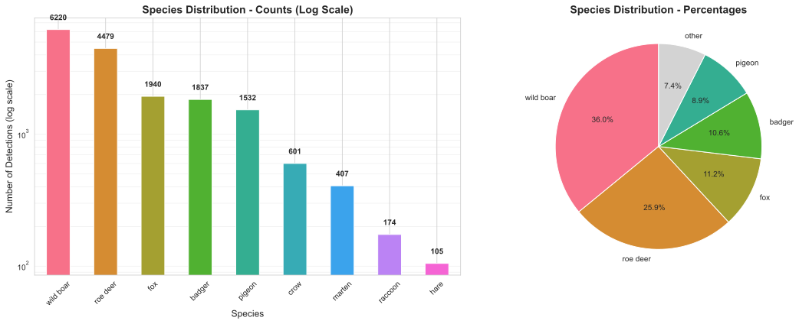
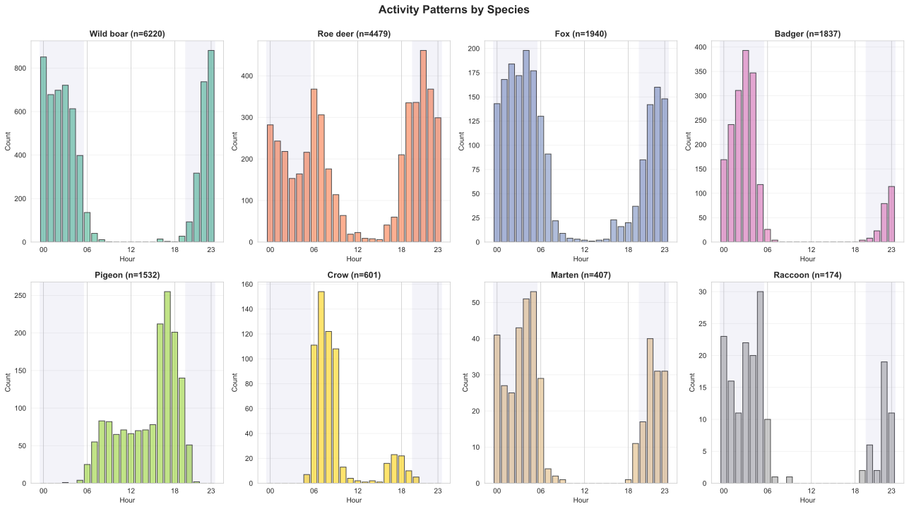
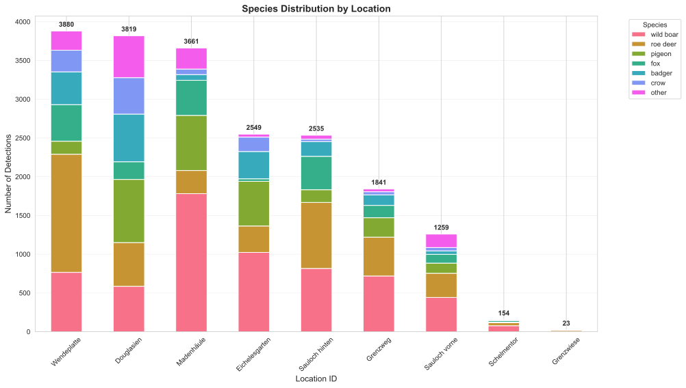
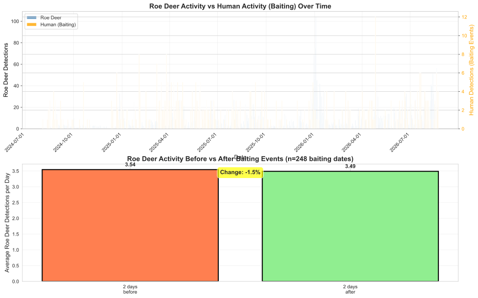
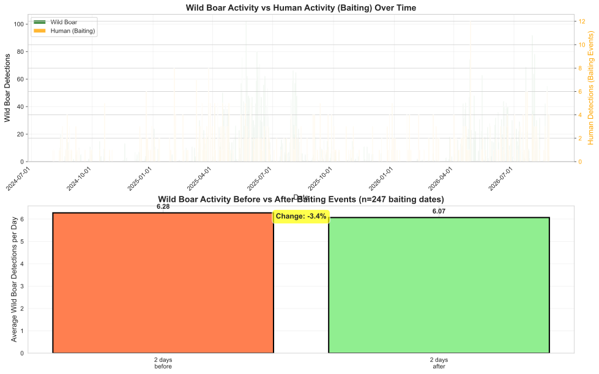
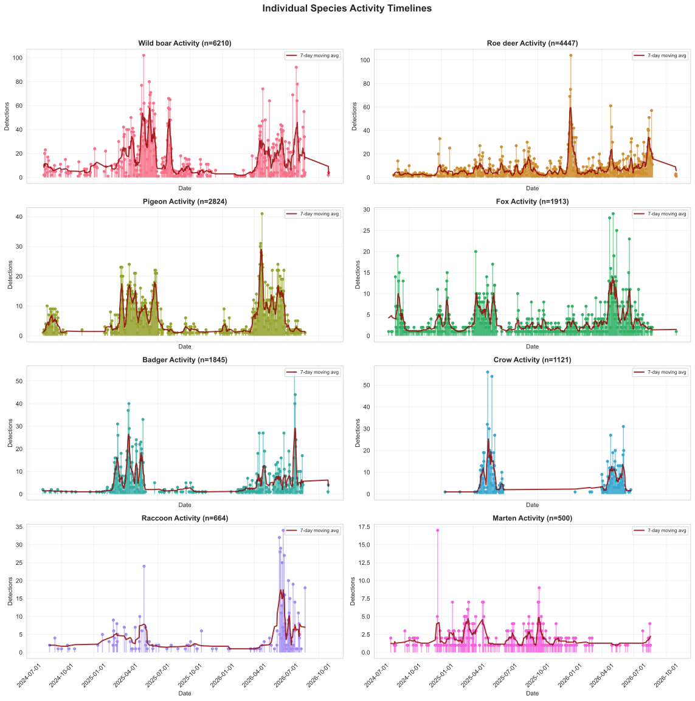
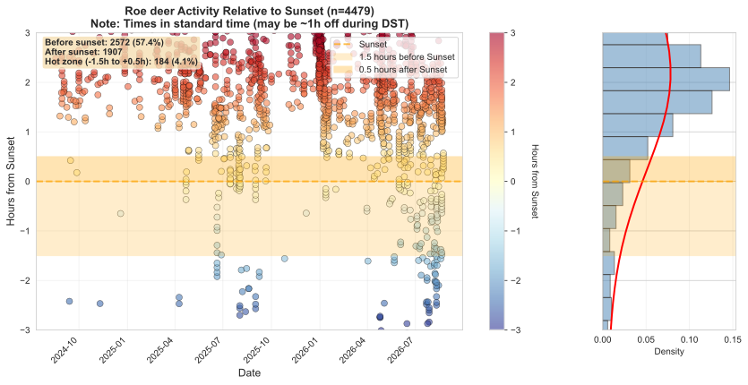
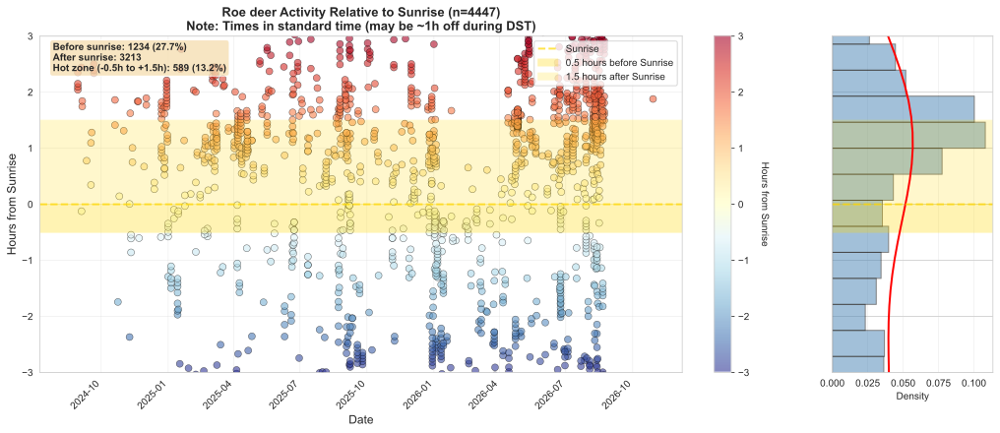
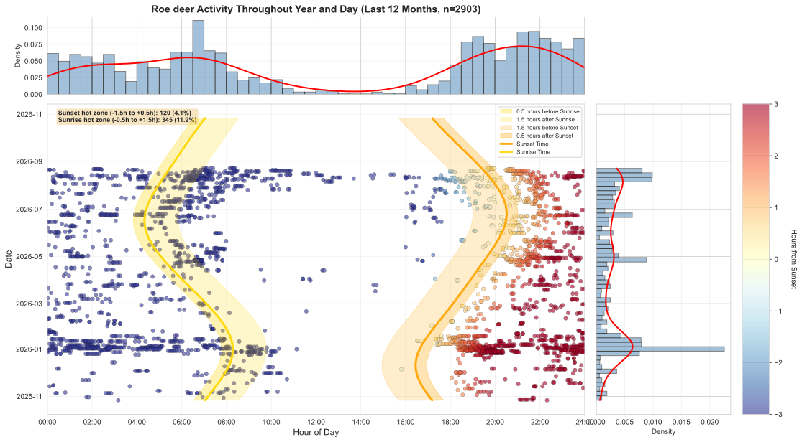
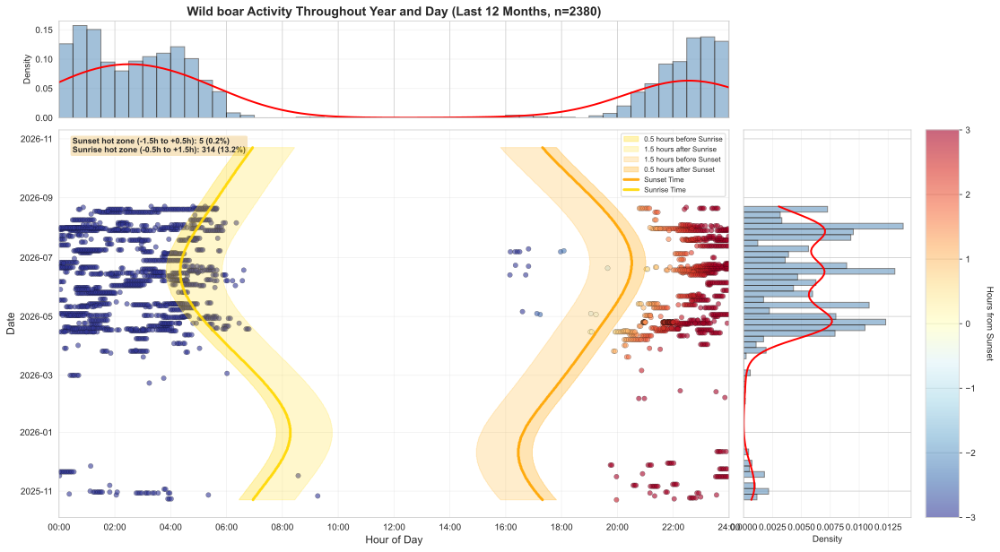

# Visualisations

Wildlife activity patterns and analysis visualisations.

## Table of Contents

- [Visualisations](#visualisations)
  - [Table of Contents](#table-of-contents)
  - [Species Distribution](#species-distribution)
    - [Species Distribution](#species-distribution-1)
  - [Activity Patterns](#activity-patterns)
    - [Species Activity Patterns](#species-activity-patterns)
  - [Environmental Factors](#environmental-factors)
    - [Location Comparison](#location-comparison)
    - [Baiting Effect Analysis - Roe Deer](#baiting-effect-analysis---roe-deer)
    - [Baiting Effect Analysis - Wild Boar](#baiting-effect-analysis---wild-boar)
  - [Activity Timeline](#activity-timeline)
    - [Individual Species Timelines](#individual-species-timelines)
  - [Crepuscular Activity Analysis](#crepuscular-activity-analysis)
    - [Roe Deer - Sunset Activity Scatter](#roe-deer---sunset-activity-scatter)
    - [Roe Deer - Sunrise Activity Scatter](#roe-deer---sunrise-activity-scatter)
    - [Roe Deer - Daily and Yearly Activity Pattern](#roe-deer---daily-and-yearly-activity-pattern)
    - [Wild Boar - Daily and Yearly Activity Pattern](#wild-boar---daily-and-yearly-activity-pattern)
  - [Summary Statistics](#summary-statistics)

## Species Distribution

### Species Distribution



Overall distribution of species detections across the study area, shown in both bar chart and pie chart formats.

## Activity Patterns

### Species Activity Patterns



Activity patterns broken down by individual species, showing hourly activity for top 8 species.

## Environmental Factors

### Location Comparison



Comparison of wildlife activity across different camera locations, showing species diversity at each site.

### Baiting Effect Analysis - Roe Deer



Impact of human activity on roe deer presence, with timeline and before/after analysis.

### Baiting Effect Analysis - Wild Boar



Impact of human activity on wild boar presence, with timeline and before/after analysis.

## Activity Timeline

### Individual Species Timelines



Separate timeline views for top 8 species, showing their individual temporal activity patterns.

## Crepuscular Activity Analysis

### Roe Deer - Sunset Activity Scatter



Scatter plot showing roe deer activity relative to sunset times throughout the year, with distribution histogram.

### Roe Deer - Sunrise Activity Scatter



Scatter plot showing roe deer activity relative to sunrise times throughout the year, with distribution histogram.

### Roe Deer - Daily and Yearly Activity Pattern



Comprehensive heatmap showing roe deer activity across hour of day and month of year (last 12 months).

### Wild Boar - Daily and Yearly Activity Pattern



Comprehensive heatmap showing wild boar activity across hour of day and month of year (last 12 months).

---

## Summary Statistics

```text

```

---

[Back to Home](index.md)
